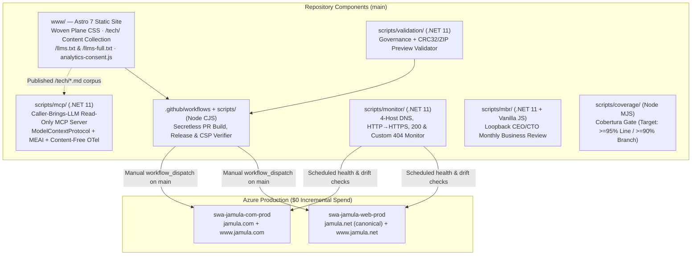

# Jamula Website

Source of truth for the public website of **Jamula, Inc.** ([`www/`](www/)), its
evidence-first architecture, privacy, legal, and product decision ledger
([`docs/`](docs/)), and first-party `.NET 11` and Node.js governance,
discovery, and operational tooling ([`scripts/`](scripts/)).

Documentation for future business-platform milestones (turnkey CRM/scheduling/billing
and the client-deployable `.NET 11` Aspire RAG accelerator) records internal
requirements, evaluations, and approval gates—not shipped features or public
commitments.

## Architecture overview



## Current repository state

- **Static public website (`www/`):** Astro (`output: "static"`,
  [`www/astro.config.ts`](www/astro.config.ts)) implementing the
  [Woven Plane design system](DESIGN.md). Renders the homepage capability
  narrative (`AI Strategy`, `Custom Software`, `Cloud Consulting`), an
  accessible `mailto:spam@jamula.net` inquiry link with plain-text fallback,
  `Organization` structured data, build-time [`/tech/`](www/src/pages/tech/index.astro)
  Astro Content Collections, static [`/llms.txt`](www/src/pages/llms.txt.ts) and
  [`/llms-full.txt`](www/src/pages/llms-full.txt.ts) discovery endpoints, a
  dedicated [`/privacy/`](www/src/pages/privacy.astro) notice, and consent-gated
  GA4 measurement controls (no server-side CMS database or contact form is deployed).
- **Approved domain and hosting policy:** `jamula.net`, `www.jamula.net`,
  `jamula.com`, and `www.jamula.com` are served directly over HTTPS across two
  Free Azure Static Web Apps (`swa-jamula-web-prod` and `swa-jamula-com-prod`).
  `jamula.net` is canonical for indexing; HTTP upgrades to HTTPS on the same
  hostname. Website operation must not add paid operating services; free-tier
  quotas and lack of an SLA remain real constraints rather than availability
  guarantees. See [`docs/architecture/two-free-static-apps.md`](docs/architecture/two-free-static-apps.md).
- **Canonical milestones (`M01`–`M05` with sub-milestones):**
  - `M01 - Public website launch & buyer trust` (`M01.01`–`M01.99`, including
    [#94](https://github.com/Jamula/Jamula-www-Website/issues/94) and
    [#95](https://github.com/Jamula/Jamula-www-Website/issues/95)).
  - `M02 - .NET 11, 95%/90% coverage & CI modernization` (`M02.01`–`M02.99`,
    raising executable coverage gates to `>=95%` line and `>=90%` branch).
  - `M03 - Zero-inference-cost MCP & content-suppressed OTel` (`M03.01`–`M03.99`,
    retargeting [#108](https://github.com/Jamula/Jamula-www-Website/issues/108),
    [#115](https://github.com/Jamula/Jamula-www-Website/issues/115),
    [#116](https://github.com/Jamula/Jamula-www-Website/issues/116),
    [#119](https://github.com/Jamula/Jamula-www-Website/issues/119), and
    [#120](https://github.com/Jamula/Jamula-www-Website/issues/120)).
  - `M04 - Turnkey business operations (CRM, scheduling & billing)` (`M04.01`–`M04.99`).
  - `M05 - Client-deployable .NET 11 Aspire RAG accelerator` (`M05.01`–`M05.99`).
- **Operational, MCP, and governance tooling (`scripts/`):**
  - [`scripts/validation/`](scripts/validation/) — `.NET 11` repository governance
    and preview-archive validator (`JamulaValidation`; live preview HTTP
    verification runs via `.github/scripts/verify-preview.cjs`).
  - [`scripts/monitor/`](scripts/monitor/) — zero-dependency `.NET 11` scheduled
    apex DNS A-record, HTTP-to-HTTPS same-host upgrade, HTTPS 200 content,
    canonical link, and Jamula custom 404 drift monitor (`JamulaMonitor`).
  - [`scripts/mbr/`](scripts/mbr/) — local loopback `.NET 11` Monthly Business
    Review dashboard (`JamulaMbr`).
  - [`scripts/mcp/`](scripts/mcp/) — `.NET 11` caller-brings-LLM read-only Model
    Context Protocol (`MCP`) server (`JamulaMcp`) built on the official
    `ModelContextProtocol.AspNetCore` C# SDK, `Microsoft.Extensions.AI.Abstractions`,
    and content-suppressed BCL OpenTelemetry (`ActivitySource` / `Meter`).
  - [`scripts/coverage/`](scripts/coverage/) — Cobertura inventory and coverage
    evaluator supporting asymmetric `>=95%` line and `>=90%` branch thresholds
    across every first-party executable component and the overall aggregate
    ([`scripts/coverage/README.md`](scripts/coverage/README.md)).

Repository workflow configuration documents the intended deployment boundary; it
does not by itself prove live DNS, TLS, secret, or account-side configuration.

## Releasing

Production is deployed only by an authorized manual, versioned `workflow_dispatch`
run from protected `main`; merging a pull request never deploys to production, and
isolated pull-request previews are never promoted.

After owner authorization, dispatch `.github/workflows/azure-static-web-apps.yml`
with the required `change_type` classification:

```sh
# Material production change: creates baseline v0.1.0 (if no release exists yet)
# or increments the next patch tag vMAJOR.MINOR.(PATCH+1)
gh workflow run azure-static-web-apps.yml --ref main -f change_type=material

# Non-material operational/script fix: reuses the latest immutable published release tag
gh workflow run azure-static-web-apps.yml --ref main -f change_type=fix
```

Monitor the run through `swa-deployment` environment approval, `.net` and `.com`
deployments, live CSP/release verification, and GitHub Release publication.
Published GitHub Releases and their `vMAJOR.MINOR.PATCH` tags (stamped into
`/release.json`) are the authoritative release history; `www/package.json` remains
the local development baseline. See the
[release runbook](docs/architecture/two-free-static-apps.md) for permissions,
verification, retries, and partial-deployment recovery.

## Local development

CI uses `global.json`-pinned `.NET 11.0` SDKs
([`scripts/validation/global.json`](scripts/validation/global.json),
[`scripts/monitor/global.json`](scripts/monitor/global.json),
[`scripts/mbr/global.json`](scripts/mbr/global.json), and
[`scripts/mcp/global.json`](scripts/mcp/global.json) via `actions/setup-dotnet`),
Node.js `26.13.0`, and npm `12.2.1`. From the repository root:

```sh
npm --prefix www ci
npm --prefix www run dev
```

Run website formatting checks, `astro check` + production static build, generated-HTML/contrast checks, and website regression suites:

```sh
npm --prefix www run format:check
npm --prefix www run build
node www/scripts/test_built_site.mjs
node --test "www/tests/*.test.mjs"
```

## Governance, security, licensing, and sponsorship

- [`PRODUCT.md`](PRODUCT.md) and [`DESIGN.md`](DESIGN.md) define current product
  truth, non-fabricated evidence boundaries, and the Woven Plane visual system.
- [`docs/README.md`](docs/README.md) indexes the architecture, legal, privacy,
  security, experience, and roadmap records.
- [`CONTRIBUTING.md`](CONTRIBUTING.md) covers branch hygiene, coding/toolchain
  standards, required validation commands, and exact-SHA PR approval rules.
- [`SECURITY.md`](SECURITY.md) covers supported versions and private vulnerability
  reporting via GitHub Security Advisories.
- [`LICENSE`](LICENSE), [`LICENSE_SCOPE.md`](LICENSE_SCOPE.md),
  [`TRADEMARKS.md`](TRADEMARKS.md), and
  [`THIRD_PARTY_NOTICES.md`](THIRD_PARTY_NOTICES.md) define the Apache-2.0 license
  grant for Jamula-authored code/technical docs, reserved Jamula brand/editorial
  exclusions, and third-party MIT attributions.
- [`.github/FUNDING.yml`](.github/FUNDING.yml) configures optional GitHub Sponsors
  support (`@cyrusjamula`) for open-source stewardship of the Apache-2.0 tooling
  and engineering templates in this repository. Sponsorship is strictly optional
  and does not purchase commercial Jamula, Inc. consulting services, support SLAs,
  or rights in reserved brand/content materials.

For governance, workflow, MCP, and `.NET 11` validation checks from the repository root:

```sh
dotnet run --project scripts/validation/JamulaValidation.csproj --configuration Release -- validate-governance .
dotnet run --project scripts/validation.tests/JamulaValidation.Tests.csproj --configuration Release
dotnet run --project scripts/validation.cli.tests/JamulaValidation.Cli.Tests.csproj --configuration Release
dotnet run --project scripts/mcp/tests/JamulaMcp.Tests.csproj --configuration Release
node --test .github/scripts/swa-preview.test.cjs .github/scripts/verify-preview.test.cjs .github/scripts/release.test.cjs
```

For `#109` coverage-inventory and template checks (requires `npm --prefix www ci`
first; see [`scripts/coverage/README.md`](scripts/coverage/README.md)):

```sh
node --test "scripts/coverage/*.test.*"
```
