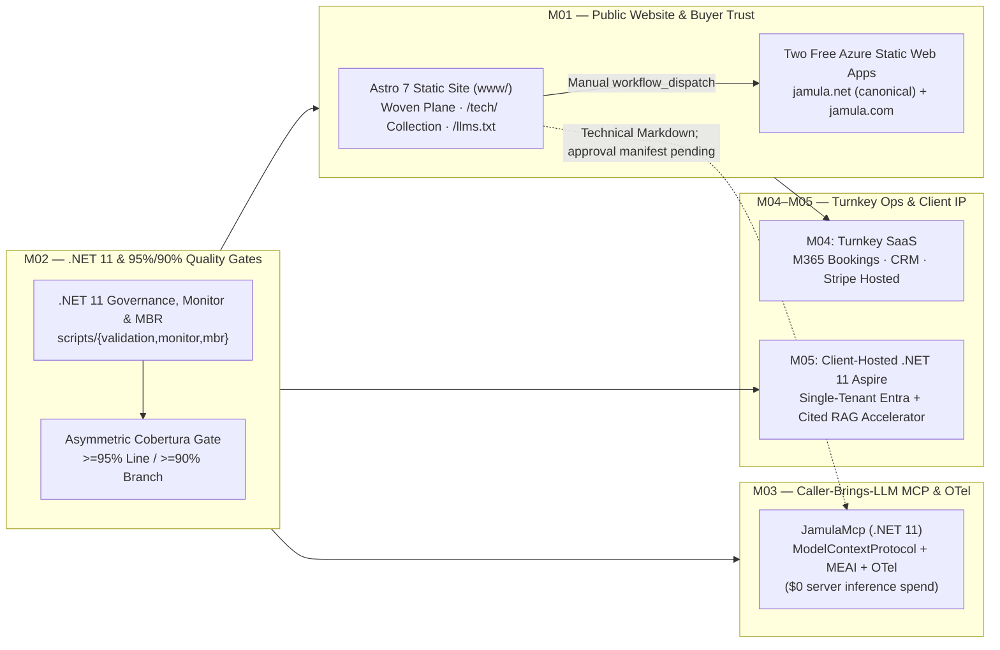

# Jamula Website Documentation

This index separates the current website from the historical platform-evaluation
package. The research, legal, cost, security, and roadmap materials below are
dated planning records, not evidence that a control, vendor, phase, professional
review, or public claim is current or approved. Check each artifact's status and
source date before relying on it.

The [current delivery roadmap](roadmap/current-roadmap.md) is the active issue map and release-gate sequence. The [current architecture and trust boundaries](architecture/current-architecture.md) distinguishes implemented, local-only and planned components.

## Architecture & milestone topology

## Current project state

- The repository contains a static Astro site under `www/` implementing the
  [Woven Plane design system](../DESIGN.md), build-time [`/tech/`](../www/src/pages/tech/index.astro)
  Astro Content Collections, and static [`/llms.txt`](../www/src/pages/llms.txt.ts) /
  [`/llms-full.txt`](../www/src/pages/llms-full.txt.ts) indexes, plus `.NET 11`
  governance, monitoring, MBR, and read-only MCP tooling under `scripts/`
  (pinned by root [`global.json`](../global.json), [`Directory.Build.props`](../Directory.Build.props),
  and [`Jamula.slnx`](../Jamula.slnx)) and native ESM CI verifiers under
  `.github/scripts/*.mjs`; local
  development and release commands are in the root [README](../README.md).
- The production deployment workflow
  ([`.github/workflows/azure-static-web-apps.yml`](../.github/workflows/azure-static-web-apps.yml))
  builds from protected `main` and deploys only via authorized manual
  `workflow_dispatch`. The approved domain policy directly serves all four
  Jamula.net/.com apex and www hostnames over HTTPS; `jamula.net` is canonical
  for indexing, and HTTP upgrades on the same hostname. This is configuration
  and policy documentation, not proof of live DNS, TLS, secret, or end-to-end
  availability.
- The approved hosting configuration uses two Free Azure Static Web Apps. The
  site must incur zero incremental paid operating-service spend; existing domain
  renewals and CI allowances are separate. Free-tier quotas and absence of an
  SLA remain constraints, not guarantees.
- On `main`, the homepage ([`www/src/pages/index.astro`](../www/src/pages/index.astro))
  renders the baseline capability narrative, `Organization` structured data, and
  an accessible `mailto:spam@jamula.net` inquiry link with plain-text fallback,
  alongside [`/tech/`](../www/src/pages/tech/index.astro) technical notes, a scoped
  analytics privacy notice at [`/privacy/`](../www/src/pages/privacy.astro), and
  consent-gated GA4 controls.
- Open work is organized across five canonical `M01`–`M05` milestones using
  hierarchical `Mxx.yy` sub-milestones (check GitHub for live issue status):
  - `M01 - Public website launch & buyer trust` (`M01.01`–`M01.99`)
  - `M02 - .NET 11, 95%/90% coverage & CI modernization` (`M02.01`–`M02.99`)
  - `M03 - Zero-inference-cost MCP & content-suppressed OTel` (`M03.01`–`M03.99`)
  - `M04 - Turnkey business operations (CRM, scheduling & billing)` (`M04.01`–`M04.99`)
  - `M05 - Client-deployable .NET 11 Aspire RAG accelerator` (`M05.01`–`M05.99`)
  - Bespoke multi-process internal `/admin` and `/finance` CMS issues (`#111`–`#114`,
    `#117`–`#118`) were retired as negative-ROI in favor of static Astro Content
    Collections, caller-brings-LLM MCP, and the client-hosted `.NET 11` Aspire
    accelerator.
- Platform-evaluation PR [#10](https://github.com/Jamula/Jamula-www-Website/pull/10)
  and bootstrap PR [#2](https://github.com/Jamula/Jamula-www-Website/pull/2)
  are merged. Their historical drafts, review findings, and approval records
  remain part of the archive; they are not current open PRs or work instructions.
- A Blazor-based site with build-time HTML articles has been discussed as a
  future direction. Astro remains the current implementation; no Blazor
  migration or prototype is authorized by the proposal.

## Current implementation and operating guidance

- [Two Static Web Apps: domain and deployment boundary](architecture/two-free-static-apps.md)
- [Platform portability and exit contract](architecture/platform-portability.md) —
  research fixture only; not a current infrastructure inventory
- [Acceptance journeys](experience/acceptance-journeys.md) and
  [accessibility, SEO, and performance requirements](experience/accessibility-seo-performance.md) —
  proposed requirements and test plans, not proof of passing results
- [Security and quality strategy](security/quality-strategy.md) —
  proposed controls and future tests
- [Side-quest feasibility assessment](architecture/side-quests-feasibility.md) —
  dated hosting, identity, inference, and local-routing evidence; not a platform approval
- [Side-quest component release contract](architecture/side-quest-release-contract.md) —
  proposal-only artifact identity, independent releases, collective manifests, and recovery
- [Side-quest quality baseline](security/side-quests-quality-baseline.md) —
  measured existing test/coverage evidence and unmeasured release gates
- [Side-quest operations review](operations/side-quest-operations-review.md) —
  monthly evidence review using the existing MBR, with data-quality and privacy rules
- [M04 turnkey operations readiness](operations/m04-turnkey-readiness.md) —
  dated vendor evidence and proposed CRM, scheduling, deletion, and reconciliation
  runbooks; not a provider selection or production approval
- [Public claims register](content/public-claims-register.md) —
  distinguishes baseline factual, inquiry, and scoped privacy copy in `main`
  source from candidate claims still awaiting formal register verification and
  owner approval
- [License and provenance inventory](legal/license-inventory.md) and
  [repository license scope](../LICENSE_SCOPE.md)

## Historical evaluation and planning documents

The evaluation work package was merged in August 2026. Its exact source dates
and proposal statuses remain in each document. The prior Jamula.com-to-Jamula.net
redirect assumption is superseded by the direct-serving policy in
[Two Static Web Apps](architecture/two-free-static-apps.md). Do not use the
historical redirect as a current requirement.

| Area | Documents |
|---|---|
| Planning and requirements | [Evaluation plan](planning/evaluation-plan.md), [business and product requirements](requirements/business-product-requirements.md), [work ownership](planning/work-ownership.md), [phase gates](roadmap/phase-gates.md), [implementation backlog](roadmap/implementation-backlog.md), [ownership matrix](roadmap/ownership-matrix.md) |
| Architecture and decisions | [Customer platform](architecture/customer-platform.md), [decision framework](architecture/decision-framework.md), [recommendation](architecture/recommendation.md), [decision index](decisions/README.md), [ADR-001](decisions/adr-001-rendering-and-content.md), [ADR-002](decisions/adr-002-hosting-dns-email-cicd.md), [ADR-003](decisions/adr-003-customer-platform-phases.md), [ADR-004](decisions/adr-004-privacy-security-reliability.md), [ADR-005](decisions/adr-005-cost-portability-and-lock-in.md), [ADR-006](decisions/adr-006-repository-content-and-legal-gates.md), [approval register](decisions/approvals.md) |
| Content and company | [Operating principles](company/operating-principles.md), [public values draft](company/public-values-draft.md), [content strategy](content/content-strategy.md), [editorial workflow](content/editorial-workflow.md), [multimedia and social plan](content/multimedia-social-plan.md), [founder profile draft](content/founder-profile-draft.md), [founder source register](content/founder-source-register.md), [homepage copy draft](content/homepage-copy-draft.md) |
| Experience | [Experience requirements](experience/experience-requirements.md), [acceptance journeys](experience/acceptance-journeys.md), [accessibility, SEO, and performance](experience/accessibility-seo-performance.md) |
| Customer platform and privacy | [Customer-platform options](research/customer-platform-options.md), [customer-platform source register](research/customer-platform-source-register.md), [data inventory](privacy/data-inventory.md), [data lifecycle](privacy/data-lifecycle.md), [connector index](spikes/connectors/README.md), [OneDrive](spikes/connectors/onedrive.md), [Google Drive](spikes/connectors/google-drive.md), [Box](spikes/connectors/box.md), [payments evaluation](payments/phase-4-evaluation.md) |
| Security and recovery | [Threat model](security/threat-model.md), [control/test matrix](security/control-test-matrix.md), [incident detection and response](security/incident-detection-response.md), [backup and recovery](security/backup-recovery.md), [supply chain](security/supply-chain.md), [quality strategy](security/quality-strategy.md) |
| Platform and cost research | [Platform options](research/platform-options.md), [platform source register](research/platform-source-register.md), [cost model](cost/cost-model.md), [reference workloads](cost/reference-workloads.md), [portability](architecture/platform-portability.md) |
| Legal issue spotting | [Jurisdiction matrix](legal/jurisdiction-matrix.md), [compliance checklist](legal/compliance-checklist.md), [legal-page requirements](legal/legal-pages-requirements.md), [content/IP review](legal/content-ip-review.md), [phase review gates](legal/phase-review-gates.md), [professional review register](legal/professional-review-register.md), [license inventory](legal/license-inventory.md) |

| Review and provenance | [Artifact manifest](artifacts-manifest.md), [Fact Checker report](reviews/fact-check-report.md), [Responsible AI review](reviews/rai-review.md), [adversarial review](reviews/adversarial-review.md) |

## Freshness and approval limits

The historical evaluation research and source registers have evidence cut-offs
in August 2026; later operational documents state their own evidence dates.
Vendor prices, quotas, legal requirements, and public-source claims can change;
those records are not live quotes or current legal advice. Verify the primary
source again before relying on a time-sensitive claim. No source date, issue
closure, review verdict, or merged documentation PR by itself approves a public
claim, professional conclusion, migration, production action, or future
product phase.

`artifacts-manifest.md`, `planning/work-ownership.md`, and
`decisions/approvals.md` retain the August evaluation package's authorship,
review, and lifecycle history. Their historical status fields are not a live
work ledger. GitHub issues are the current durable follow-up ledger.
