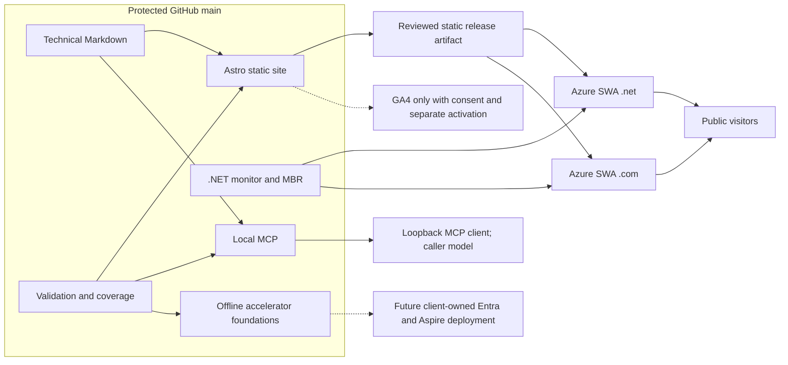
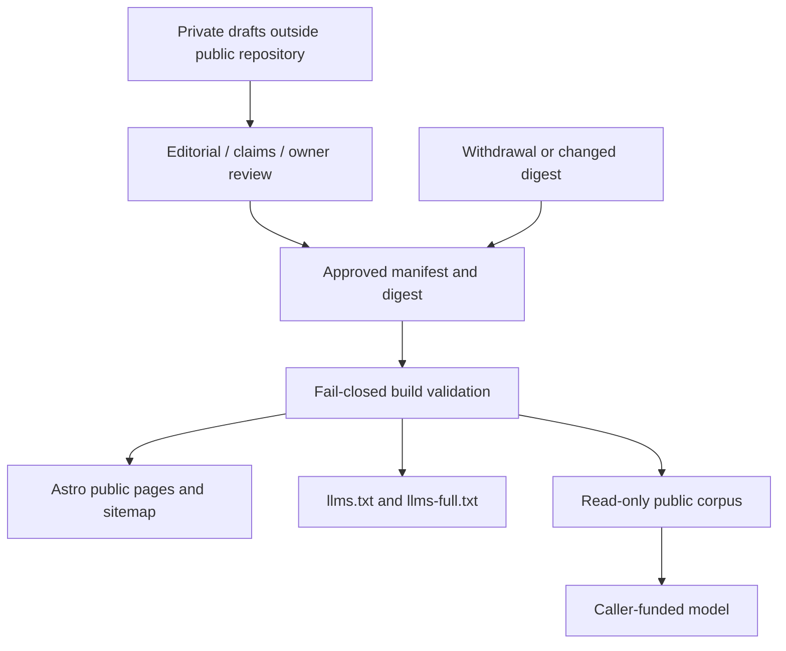
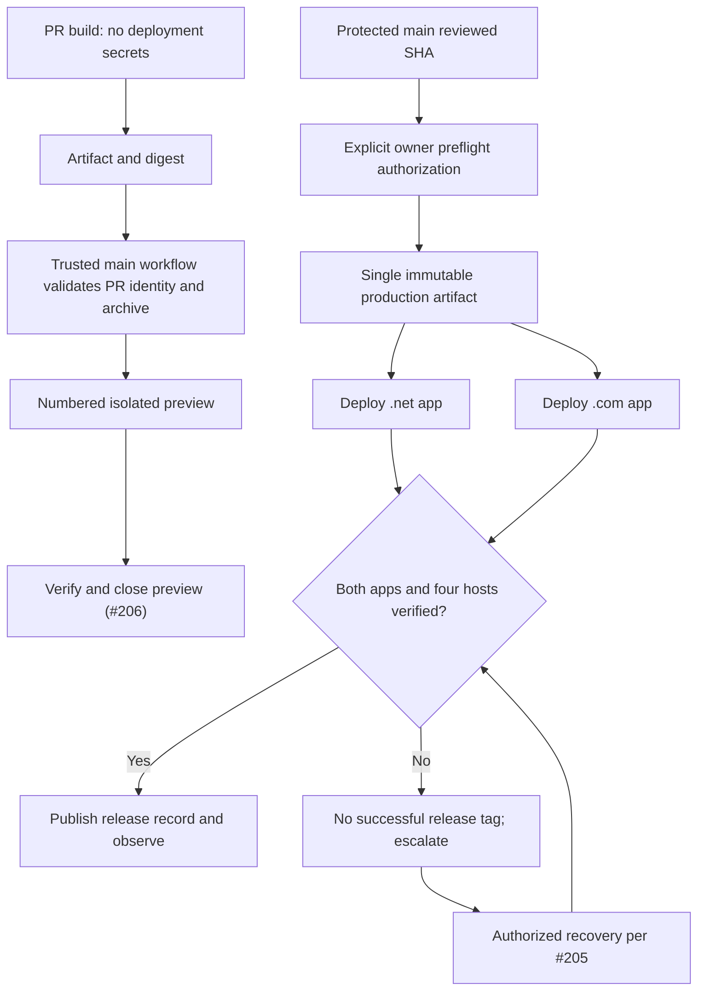
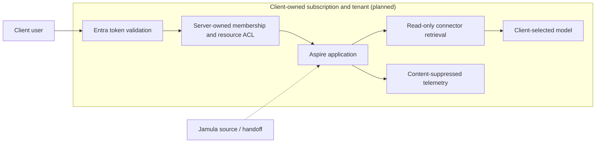

# Current architecture and trust boundaries

**Status:** Current source topology and proposed future boundaries, as of 2026-11-28. This is not a deployment inventory, provider selection, or approval. See [current delivery roadmap](../roadmap/current-roadmap.md) for gates and [two free Static Web Apps](two-free-static-apps.md) for the approved site topology.

## Component and data flow

The site has no deployed server CMS or customer portal. The two-site hosting configuration is implemented in source; the latest monitor reported all four homepage origins returning 404. M03 is loopback-only, and the client accelerator lacks an integrated host and live authentication. The dashed paths are conditional or future.

## Publication boundary (proposed, #207)

Today Astro and MCP load technical Markdown without a shared explicit approval manifest. Do not represent the diagram as an implemented security control. Never commit private content to this public repository.

## Preview versus production

Recovery, partial-failure behavior and Azure cleanup require exact-artifact rehearsal and live evidence. No automated rollback or production operation is implied. Production dispatch is separately authorized; never promote a PR preview.

## Future client-owned accelerator boundary (M05)

No Jamula-hosted customer data, multi-tenant custody, production credentials or client inference spend is introduced by the offline foundations. The actual host, token validation, revocation, ACL enforcement, connector integration, and telemetry exporter are unimplemented or unverified gates.

## Infrastructure boundary

Existing parent DNS, mail and registrar are independent trust boundaries; delegated app-subdomain DNS is a separate proposed decision. No delegation, provider choice, paid resources or DNS modifications are authorized. SoftwareFactory is workflow orchestration, not cloud-resource or DNS ownership.
