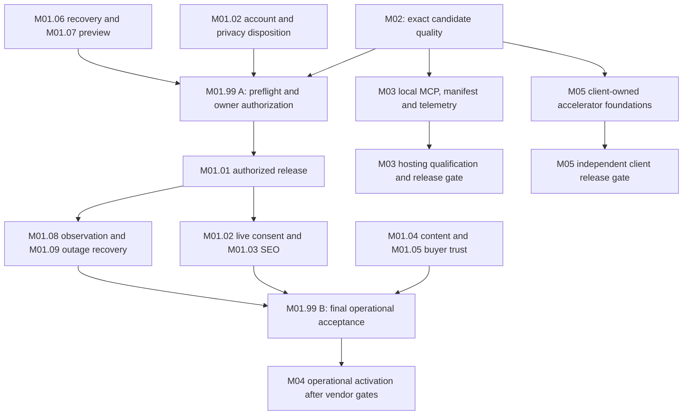

# Current delivery roadmap

**Status:** Planning and evidence snapshot, 2026-11-28. GitHub issues are the live source of status. Baseline source: `2484548fed85890d13e4e2e1de3c7cbf2ab43dce`. No merge, account change, paid service, claims approval, analytics activation or production release is authorized by this document.

## Milestones and execution order

Retain existing milestone IDs and names in GitHub; the outcome labels below clarify scope. Do not start another orchestration or infrastructure project in this repository. Estimates are deliberately unscheduled until owner/account gates and measured work are available.

| Milestone | Outcome | Exit evidence | Priority |
| --- | --- | --- | --- |
| M01 | Public production, recovery and buyer trust | Approved exact revision, four healthy hosts, operational evidence, buyer-trust and measurement dispositions | P0 |
| M02 | Reproducible engineering and maintainability | Exact-revision CI, per-component and aggregate 95% line / 90% branch, current docs and independent review | P0 |
| M03 | Secure public MCP and AI discovery | Approved public manifest, local behavior, hosting/quotas/privacy qualification and separately authorized release | P1 |
| M04 | Turnkey consulting operations | Vendor, account, privacy, payment and professional gates; operational rehearsal | P2 |
| M05 | Client-owned enterprise AI accelerator | Single-tenant live auth, cited ACL-filtered retrieval, deployment handoff and independent review | P2 |

M03 local development, M04 vendor research and M05 offline work can proceed independently of M01 launch. M03 public hosting is not a prerequisite for M04 or M05. M01 production authorization precedes post-deployment evidence; it does not depend on it.

## Open issue inventory

This snapshot contains 25 open issues in five milestones. Links resolve to live GitHub status; a merged PR does not establish release acceptance.

| Sub-milestone | Issue | Next action / dependency |
| --- | --- | --- |
| M01.01 | [#183](https://github.com/Jamula/Jamula-www-Website/issues/183) | Prepare first release; preflight #205/#206 and #180 checkpoint A; then four-host validation |
| M01.02 | [#95](https://github.com/Jamula/Jamula-www-Website/issues/95) | Owner/admin vendor and privacy disposition before activation; live verification after #183 |
| M01.03 | [#94](https://github.com/Jamula/Jamula-www-Website/issues/94) | Search Console and SEO evidence after #183 |
| M01.04 | [#182](https://github.com/Jamula/Jamula-www-Website/issues/182) | Built routes exist; exact-artifact and claims evidence; coordinate #207 |
| M01.05 | [#181](https://github.com/Jamula/Jamula-www-Website/issues/181) | Owner-confirmed inquiry alias and approved claims; no inferred approval |
| M01.06 | [#205](https://github.com/Jamula/Jamula-www-Website/issues/205) | Dual-app recovery, partial-failure rehearsal and account preflight |
| M01.07 | [#206](https://github.com/Jamula/Jamula-www-Website/issues/206) | Preview cleanup and isolation; verify actual Azure mechanism |
| M01.08 | [#209](https://github.com/Jamula/Jamula-www-Website/issues/209) | Readiness evidence, monitoring and recovery observation |
| M01.09 | [#204](https://github.com/Jamula/Jamula-www-Website/issues/204) | Active outage; close only after successful recovery monitor |
| M01.99 | [#180](https://github.com/Jamula/Jamula-www-Website/issues/180) | A: authorize exact release; B: close after live evidence |
| M02.03 | [#109](https://github.com/Jamula/Jamula-www-Website/issues/109) | Current nine-component coverage and quality evidence |
| M02.05 | [#208](https://github.com/Jamula/Jamula-www-Website/issues/208) | Roadmap, diagrams, doc consistency and verified cleanup |
| M02.99 | [#191](https://github.com/Jamula/Jamula-www-Website/issues/191) | Exact-SHA independent and owner acceptance |
| M03.01 | [#108](https://github.com/Jamula/Jamula-www-Website/issues/108) | Public hosting and zero-paid-overflow feasibility; local development may proceed |
| M03.02 | [#116](https://github.com/Jamula/Jamula-www-Website/issues/116) | Local MCP implementation exists; public exposure blocked by #108/#115/#207/#120 |
| M03.03 | [#115](https://github.com/Jamula/Jamula-www-Website/issues/115) | Content-free telemetry, quotas, public-host integration |
| M03.04 | [#119](https://github.com/Jamula/Jamula-www-Website/issues/119) | MBR evidence review after #115 |
| M03.05 | [#207](https://github.com/Jamula/Jamula-www-Website/issues/207) | Explicit approved corpus manifest shared by site/LLM/MCP |
| M03.99 | [#120](https://github.com/Jamula/Jamula-www-Website/issues/120) | Current public-only exact-artifact gate; #108/#109/#115/#116/#119/#207 |
| M04.01 | [#186](https://github.com/Jamula/Jamula-www-Website/issues/186) | CRM/scheduling vendor and account qualification |
| M04.02 | [#187](https://github.com/Jamula/Jamula-www-Website/issues/187) | Hosted payment and professional reconciliation gates |
| M04.99 | [#193](https://github.com/Jamula/Jamula-www-Website/issues/193) | #186/#187 and operational acceptance before activation |
| M05.01 | [#189](https://github.com/Jamula/Jamula-www-Website/issues/189) | Aspire host, actual Entra auth, membership and IaC beyond offline foundations |
| M05.02 | [#188](https://github.com/Jamula/Jamula-www-Website/issues/188) | #189, cited ACL-aware read-only RAG and connectors |
| M05.99 | [#194](https://github.com/Jamula/Jamula-www-Website/issues/194) | Exact-artifact evidence from #189/#188, independent security/privacy/RAI review |

## Production readiness evidence

Baseline: [monitor run 46146354156](https://github.com/Jamula/Jamula-www-Website/actions/runs/46146354156) reported four HTTP 404s, canonical apex DNS and same-host upgrades passing. [Preview run 46114271793](https://github.com/Jamula/Jamula-www-Website/actions/runs/46114271793) failed cleanup. [PR #198](https://github.com/Jamula/Jamula-www-Website/pull/198) reported 98.88% line and 96.38% branch aggregate before subsequent component additions; not current exact-SHA proof. No published release at snapshot.

| Dimension | Required evidence | Tracking |
| --- | --- | --- |
| Availability | Four healthy HTTPS origins, release identity, correct 404/canonical/redirects | #183, #204 |
| Deployment and recovery | Exact artifact, no production preview fallback, safe dual-app recovery, no tag on partial failure | #205, #206 |
| Security and quality | Required CI, coverage, supply-chain, security, manual accessibility/performance evidence | #109, #191, #209 |
| Operations | Monitor freshness, incident ownership, observation window, quota/free-tier evidence | #209 |
| Data/privacy | Dated administrator evidence, explicit vendor/activation approval, live four-origin consent behavior | #95 |
| Commercial | Working inquiry, approved claims, search visibility baseline | #181, #94 |

An unresolved mandatory gate is a release blocker, regardless of aggregate score. No claim of availability or compliance follows from a green build. An analytics-disabled candidate may be proposed for explicit approval if activation remains blocked; no silent bypass.

## Cleanup disposition

- Retire duplicate root website ignore rules only; the existing `www/.gitignore` already ignores `dist/`, `node_modules/`, and `.astro/` locally (including nested matches). Keep secret, .NET and MBR rules.
- The retired side-quest artifact spike is no longer present; remove its dangling live-looking link while preserving historical provenance.
- Retain historical legal, claims, professional-review, cost and architecture records. Do not rewrite historical approvals or convert them into current claims.
- The inactive `squad-state` branch is a cleanup candidate, not authorized for deletion without archive/reference review. Retain design mock assets, executable tooling and test fixtures until reference and behavior evidence proves redundancy.
- Full source-level unused-symbol and dependency analysis, all-document link validation, independent review and exact-PR CI remain acceptance work under #208.
